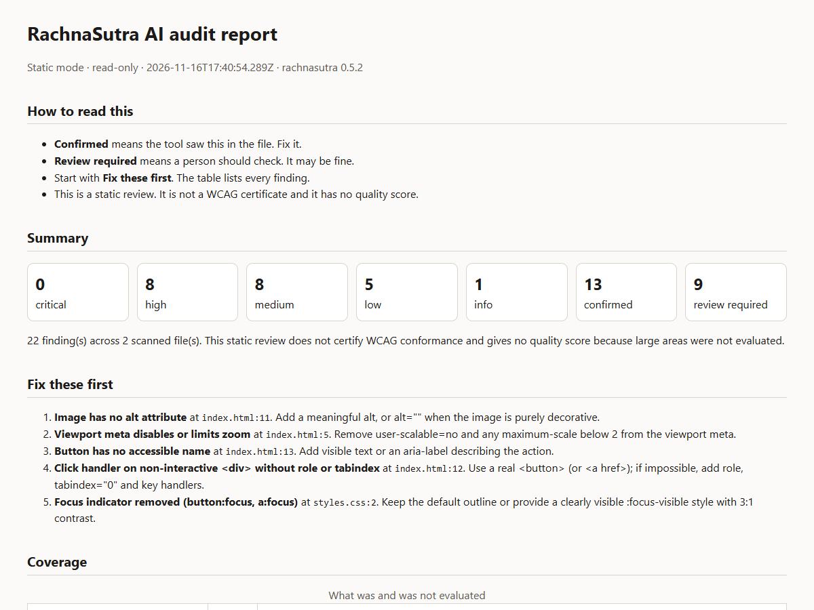
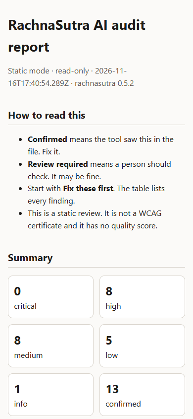

# Five-minute tour

This page takes you from nothing to a fixed, verified page in about five minutes. Every command and every output below was run for real on the sample pages in this repository; nothing is mocked. You need Node.js 20 or newer. You do **not** need an account, an API key or a network connection after the first download.


## Step 1. Run the audit

Point the tool at any folder that contains front-end source (HTML, CSS, JSX, TSX, Vue, Svelte, Astro). It only reads files.

```bash
npx rachnasutra audit .
```

You get a short summary in the terminal and three report files next to where you ran the command:

```text
Wrote:
  rachnasutra-reports/latest.md
  rachnasutra-reports/latest.html
  rachnasutra-reports/latest.json
Scanned 2 file(s). 22 finding(s): 0 critical, 8 high, 8 medium, 5 low, 1 info.
  RS-0001 [high/confirmed] RS-A11Y-001 index.html:11 - Image has no alt attribute
  RS-0002 [high/confirmed] RS-A11Y-003 index.html:5 - Viewport meta disables or limits zoom
  RS-0003 [high/confirmed] RS-A11Y-004 index.html:13 - Button has no accessible name
  RS-0007 [high/confirmed] RS-A11Y-013 index.html:20 - Text contrast 2.32:1 is below 4.5:1 (#aaaaaa on #ffffff)
  ...
Not evaluated: browser runtime, visual review, screen-reader and keyboard testing, Core Web Vitals (lab and field).
This is not a WCAG conformance statement.
```

> **Note:** Your source files are never changed. The only files written are the reports in `rachnasutra-reports/`, which is git-ignored. Use `--no-report` if you want the summary only.

Read each finding line like this: `RS-0001` is the stable ID, `[high/confirmed]` is severity and status, `RS-A11Y-001` is the rule, `index.html:11` is the exact file and line.

## Step 2. Open the HTML report

Open `rachnasutra-reports/latest.html` in any browser. It is one self-contained file: no scripts, no network, works offline, supports light and dark mode, and is itself built to be accessible.





The report is built in a fixed order, so once you have read one you can read them all:


### Why some findings say "confirmed" and some "review required"


**Confirmed** means the tool saw the problem in the file, or measured it (for example a contrast ratio of 2.32:1). Fix those. **Review required** means a person should look, because something outside the file (a component wrapper, a template) might already handle it.

## Step 3. Fix the top items

The three highest-impact fixes in the sample, with the exact change:

```html
<!-- before -->
<meta name="viewport" content="width=device-width, initial-scale=1, user-scalable=no">

<button class="icon-btn"></button>

<!-- after -->
<meta name="viewport" content="width=device-width, initial-scale=1">

<button class="icon-btn" aria-label="Open menu"></button>
```

Want a ready-made ordered to-do list first? Ask for a fix plan. It changes nothing:

```bash
npx rachnasutra plan-fixes --report rachnasutra-reports/latest.json
```

## Step 4. Prove it worked

Re-run against the baseline report you just saved. The tool matches findings by a fingerprint, so line-number changes do not confuse it:

```bash
npx rachnasutra verify --report rachnasutra-reports/latest.json .
```

```text
Baseline 22 -> current 18
Resolved: 4  Remaining: 18  Introduced: 0
  resolved   RS-A11Y-001 index.html:11
  resolved   RS-A11Y-003 index.html:5
  resolved   RS-A11Y-004 index.html:13
  resolved   RS-PERF-001 index.html:11
Static re-check only; manual accessibility and visual verification are still needed.
```

Four fixed, nothing new broken (`Introduced: 0`). If a change introduces a new finding the command exits with code 4, so a script or CI job notices.


## Step 5. Keep it fixed

Add one line to your CI so a confirmed high-severity problem can never be merged again:

```bash
npx rachnasutra ci .
```


## What to do next

| I want to... | Go to |
|---|---|
| See realistic situations and the exact commands for each | [Real-world scenarios](19-real-world-scenarios.md) |
| Learn every command and option | [User guide](05-user-guide.md) |
| Understand what each rule checks and where it can be wrong | [Audit rules reference](06-audit-rules-reference.md) |
| Let my AI IDE do the review and the edits safely | [Skills and agents](07-skills-and-agents.md) |
| Decide whether I can trust the results | [Validation and benchmarks](16-validation-and-benchmarks.md) |

## Before you share a report or claim "accessible"

A clean report means the static rules found nothing. It does **not** mean the interface is accessible. Before any claim, also run these by hand: a keyboard-only pass of every key flow, a screen-reader pass, 200% zoom and 320 px width reflow, reduced-motion and high-contrast modes. The report's Limitations section lists exactly what was not tested.
